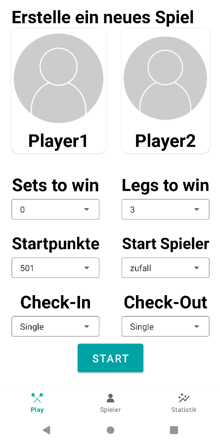
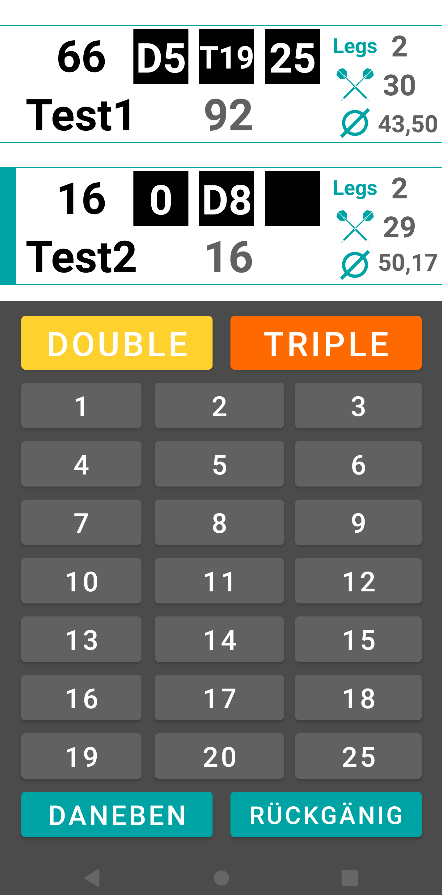
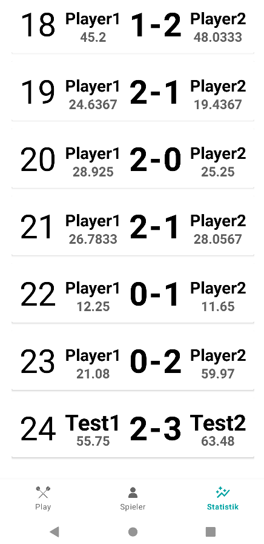

# 🎯 M501 – Darts Scorer für Android

**M501** ist eine native Android-App zum Mitzählen von Darts-Spielen für zwei Spieler. Sie unterstützt klassische x01-Spiele (Standard: 501) mit konfigurierbaren Legs, Checkout-Regeln und automatischer Statistik-Speicherung.

### Settings



### Game



### Statistik



### Demo-Video

Ein vollständiger Einblick in die Funktionen und den Spielablauf der App ist im Video [`demo.mp4`](demo.mp4) zu sehen.

---

## Features

- **Zwei-Spieler-Modus** mit Live-Anzeige von Restpunktzahl, Average, geworfenen Darts und Legs
- **Konfigurierbare Spieloptionen**
  - Startpunkte (z. B. 301, 501, 701 …)
  - Anzahl der Legs zum Sieg
  - Startspieler: Spieler 1, Spieler 2 oder zufällig
  - Checkout-Modus: **Single Out**, **Double Out** oder **Master Out**
- **Eingabe pro Dart** über ein Tastenfeld (1–20, 25, „Daneben") mit **Double**- und **Triple**-Modifikatoren
- **Bust-Erkennung** (Überwerfen, Rest 1 bei Double/Master Out, ungültiges Finish) – die Aufnahme wird automatisch zurückgesetzt
- **Rückgängig-Funktion** (Undo-Stack mit bis zu 100 Schritten)
- **Sprachausgabe** (Text-to-Speech, deutsch) der Aufnahme nach jedem Wurf-Zyklus
- **Abwechselnder Leg-Start** zwischen den Spielern
- **Average-Berechnung** (3-Dart-Average) pro Leg und über das gesamte Spiel
- **Statistik-Verlauf**: Abgeschlossene Spiele werden lokal in einer SQLite-Datenbank gespeichert und in einer Liste angezeigt
- **Bottom Navigation** zwischen „Play" (Spiel erstellen) und „Statistik"
- Edge-to-Edge-UI und Splash Screen

---

## Tech Stack

| Bereich              | Technologie                                                                         |
| -------------------- | ----------------------------------------------------------------------------------- |
| Sprache              | Java (Activities/Fragments)                                                         |
| UI                   | XML-Layouts mit `ConstraintLayout`, `CardView`, `RecyclerView`, Material Components |
| Navigation           | `BottomNavigationView` + Fragments                                                  |
| Persistenz           | SQLite (`SQLiteOpenHelper`)                                                         |
| Audio                | Android `TextToSpeech`                                                              |
| Build                | Gradle (Groovy DSL), Version Catalog (`libs`)                                       |
| Min SDK              | 27 (Android 8.1)                                                                    |
| Target / Compile SDK | 34 (Android 14)                                                                     |

---

## Projektstruktur (Auszug)

```
app/src/main/
├── AndroidManifest.xml
├── java/com/example/M501/
│   ├── MainActivity.java
│   ├── Play.java
│   ├── Statistik.java
│   ├── GameActivity.java
│   ├── DatabaseHelper.java
│   ├── choose_player.java
│   ├── choosePlayerCustomAdapter.java
│   ├── CustomAdapter.java
│   ├── CustomAdapterStatistiken.java
│   ├── GameFragment.java
│   ├── Player.java
│   └── Statistik.java
└── res/layout/
    ├── activity_main.xml
    ├── activity_game.xml
    ├── fragment_play.xml
    ├── dialog_layout.xml
    ├── fragment_choose_player.xml
    ├── fragment_game.xml
    ├── fragment_player.xml
    ├── list_item1.xml
    ├── my_row.xml
    ├── my_row_statistik.xml
    └── fragment_statistik.xml
```

---

## Spielablauf

1. Im Tab **Play** Spielernamen, Startpunkte, Legs, Startspieler und Checkout-Modus wählen.
2. Mit **Start** wird die `GameActivity` geöffnet; die Einstellungen werden per Intent übergeben:

   | Intent-Extra                   | Bedeutung                            |
   | ------------------------------ | ------------------------------------ |
   | `Spieler1Name`, `Spieler2Name` | Namen der Spieler                    |
   | `Startpunkte`                  | Startpunktzahl (Standard 501)        |
   | `Legs`                         | Legs zum Gewinn (Standard 3)         |
   | `Checkout`                     | `Single`, `Double` oder `Master`     |
   | `Startspieler`                 | `Spieler1`, `Spieler2` oder zufällig |

3. Pro Dart den Zahlenwert drücken – optional vorher **Double** oder **Triple** wählen. „Daneben" zählt 0 Punkte.
4. Nach drei Darts wechselt der Spieler automatisch, die Aufnahme wird angezeigt und vorgelesen.
5. Wer das Leg per gültigem Checkout beendet, bekommt es gutgeschrieben. Nach dem letzten nötigen Leg wird das Spiel in der Datenbank gespeichert.

---

## Datenbank

Datei: `Darts.db` (Version 1)

**Tabelle `player`**

| Spalte    | Typ                        |
| --------- | -------------------------- |
| `_id`     | INTEGER, PK, AUTOINCREMENT |
| `_name`   | TEXT                       |
| `_spiele` | INTEGER                    |
| `_siege`  | INTEGER                    |

**Tabelle `games`**

| Spalte                 | Typ                        |
| ---------------------- | -------------------------- |
| `_id2`                 | INTEGER, PK, AUTOINCREMENT |
| `_player1`, `_player2` | TEXT                       |
| `_legs1`, `_legs2`     | INTEGER                    |
| `_avg1`, `_avg2`       | FLOAT                      |

---

## Installation & Build

### Voraussetzungen

- Android Studio (aktuelle Version)
- JDK 8 oder höher
- Android-Gerät oder Emulator mit **Android 8.1 (API 27)** oder neuer

### Schritte

```bash
git clone https://github.com/MaAntBrum/Darts-Scorer.git
cd Darts-Scorer
```

1. Projekt in Android Studio öffnen (**File → Open**).
2. Gradle-Sync abwarten.
3. App auf Gerät/Emulator starten (**Run ▶**).

---

## Hinweise

- Die Sprachausgabe nutzt die deutsche Locale; auf dem Gerät muss eine deutsche TTS-Stimme installiert sein.
- Die Beschriftungen in der App sind überwiegend auf Deutsch.

---

## Mögliche Erweiterungen

- Check-In-Modi (Double In / Master In)
- Mehr als zwei Spieler
- Spielerprofile mit Gesamtstatistik (Tabelle `player` ist bereits vorbereitet)
- Checkout-Vorschläge
- Sets-Modus

---
